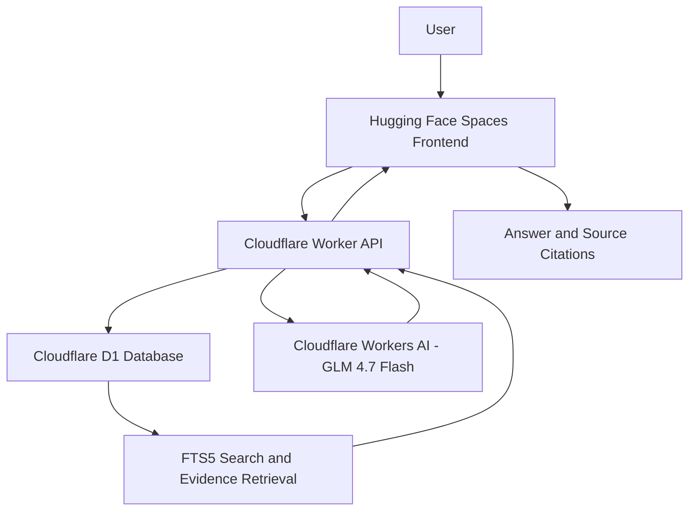

# Sakhi 2.0 – System Architecture

## 1. Overview

Sakhi 2.0 is an AI-powered assistant designed to help users understand Indian government schemes through natural-language questions.

The current public deployment supports English-language queries and uses Retrieval-Augmented Generation (RAG) to generate answers grounded in scheme documents.

## 2. Architecture

## 3. Main Components

### Frontend
- Hosted on Hugging Face Spaces.
- Built using HTML, CSS and JavaScript.
- Provides the chat interface.
- Supports voice input and text-to-speech.
- Displays answers and source references.
- Stores local chat history in the browser.

### Backend
- Hosted using Cloudflare Workers.
- Handles user questions and API requests.
- Retrieves relevant scheme information.
- Generates grounded responses using an AI model.
- Performs citation validation.

### Database
- Cloudflare D1 database.
- Stores processed government scheme document chunks.
- Uses SQLite FTS5 for full-text search.

### AI Model
- Cloudflare Workers AI.
- Model: `@cf/zai-org/glm-4.7-flash`.
- Generates answers using retrieved evidence.

## 4. Dataset

The research dataset contains:

| Description | Count |
|---|---:|
| Original PDF collection | 2,876 |
| Unique document contents | 2,066 |
| Extracted pages | 2,894 |
| Final text chunks | 11,023 |

The original document collection was processed, cleaned, and divided into overlapping text chunks for retrieval.

## 5. Request Workflow

1. A user submits a question through the frontend.
2. The frontend sends the question to the Cloudflare Worker.
3. The backend searches the D1 database using FTS5.
4. Relevant evidence is selected from scheme documents.
5. The retrieved evidence is passed to the AI model.
6. The generated answer undergoes citation checks.
7. The response and available source references are returned to the frontend.

## 6. API Endpoints

| Endpoint | Purpose |
|---|---|
| `/health` | Health check |
| `/search` | Search scheme information |
| `/ask` | Generate an evidence-grounded answer |
| `/import` | Import scheme document chunks (protected endpoint) |

## 7. Current Limitations

- The deployed version currently supports English.
- Responses depend on the available scheme documents and retrieval quality.
- Chat history is stored locally in the browser.
- Sakhi 2.0 is an independent research prototype, not an official government service.

## 8. Future Work

- Multilingual support for Indian languages.
- Cross-language scheme retrieval.
- Improved retrieval and evaluation.
- Further improvements to voice interaction.
- More comprehensive scheme coverage.

---

**Project:** Sakhi 2.0  
**Developer:** Raghuwarna Erugurala
